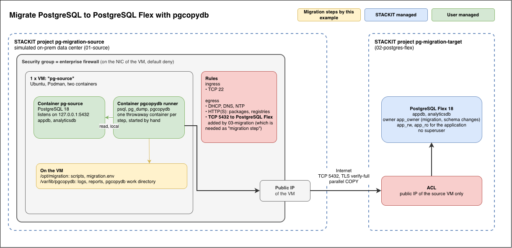
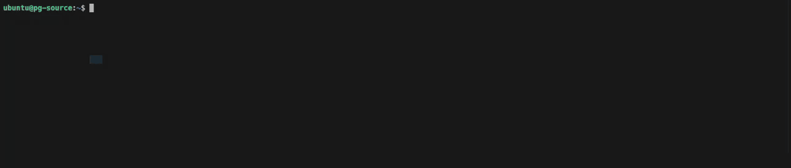
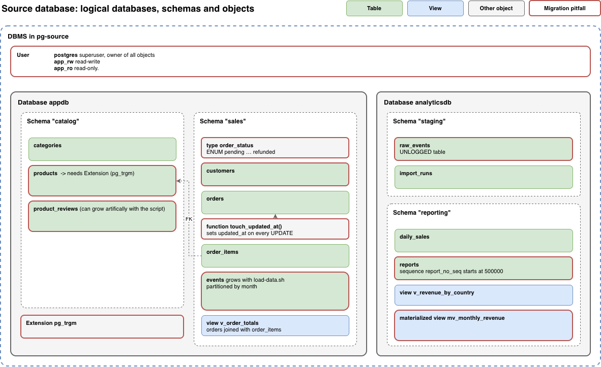

<!-- tags: dbaas, postgresql, migration, pgcopydb, on-premises, firewall, podman -->

# Migrate PostgreSQL to PostgreSQL Flex with pgcopydb

Moves the databases of a self-managed PostgreSQL (e.g. onprem, but in this demo from a STACKIT VM) into STACKIT PostgreSQL Flex with
[pgcopydb](https://github.com/dimitri/pgcopydb): one consistent copy during a write
freeze, then a check that source and target are identical.

`pgcopydb` is also used by other Cloud Providers for their Migration Service, e.g. [Azure](https://learn.microsoft.com/en-us/azure/postgresql/migrate/migration-service/overview-migration-service-postgresql#get-more-information).

The example builds the whole path, including a stand-in for the customer's data center
with an enterprise firewall in front of the database. This Terraform project is more some kind of demo. The steps and scripts in `03-migration` must be adjusted to your specific setup in your current on-prem setup.

<table>
  <thead>
    <tr>
      <th>Stage</th>
      <th>Creates</th>
    </tr>
  </thead>
  <tbody>
    <tr>
      <td><a href="01-source"><code>01-source</code></a></td>
      <td>Project, network, a VM with PostgreSQL in Podman, seed data, and a security group as enterprise firewall</td>
    </tr>
    <tr>
      <td><a href="02-postgres-flex"><code>02-postgres-flex</code></a></td>
      <td>Second project, PostgreSQL Flex instance, user and empty databases, ACL for the source VM only</td>
    </tr>
    <tr>
      <td><a href="03-migration"><code>03-migration</code></a></td>
      <td>The firewall opening to PostgreSQL Flex, plus the pgcopydb runner on the source VM</td>
    </tr>
  </tbody>
</table>

Terraform builds infrastructure and stops there. The migration itself is a sequence of
scripts you run on purpose, because it has a write freeze and ends with a
cutover decision. This is not something which should be demo-ed with Terraform.

## How it works



Two gates sit on the path, one per side, as in a real migration:

- **Source side, the enterprise firewall.** A STACKIT security group on the NIC of the
  VM. It starts with default deny in both directions and only lets the VM resolve names,
  reach package mirrors and registries, and sync its clock (which stands for typical firewall
  restrictions). `03-migration` adds the one rule the migration needs: egress to the addresses 
  of PostgreSQL Flex on port 5432. In a real world scenario this is the change request to the firewall team.
- **Target side, the ACL of PostgreSQL Flex.** `02-postgres-flex` lets in the public IP
  of the source VM and nothing else.

pgcopydb runs on the source VM, like a migration host next to the database. It reads the
source locally, streams the data with parallel `COPY` into PostgreSQL Flex, and builds
indexes and constraints on the target afterwards. Nothing is staged on disk.

## Why no Logical Replication / Why pgcopydb without `--follow`

PostgreSQL Flex (currently) cannot open outbound connections, so native logical replication (the
target subscribes to the source) is ruled out. `pgcopydb clone --follow` would work in
principle, but needs `EXECUTE` on the `pg_replication_origin_*` functions, which is not granted by PostgreSQL Flex currently. Plain `pgcopydb clone` works with the default `login` and `createdb`
roles. The price is a write freeze for the duration of the copy.

## PostgreSQL versions

The target major version must be at least the one of the source, and `pg_dump` in the
runner at least the one of the source. The runner image is built with the client tools
of the target major version, and pgcopydb in it must support that version.
`00-build-runner.sh` and the preflight check this. The example was tested with
PostgreSQL 18 on both sides.

## Order

```bash
cd 01-source
cp terraform.tfvars.example terraform.tfvars   # parent container, email, SSH key
terraform init && terraform apply

cd ../02-postgres-flex
cp terraform.tfvars.example terraform.tfvars   # parent container, email
terraform init && terraform apply

cd ../03-migration
terraform init && terraform apply
```

Each stage reads the outputs of the previous ones from their local state files. Nothing
is copied by hand. After `01-source` the VM needs a few more minutes to pull the image
and load the seed data, and creating the PostgreSQL Flex instance takes a while too.

Optional, for a more realistic copy: fill `appdb` up to a few GB on the source VM before
`03-migration`:

```bash
ssh ubuntu@<public ip of 01-source>
sudo /opt/pg-source/load-data.sh 2      # target size in GB
```

## Migration runbook

On the source VM, once per database (`appdb`, then `analyticsdb`). `terraform output
next_steps` in `03-migration` prints the same.

```bash
ssh ubuntu@<public ip of 01-source>
cd /opt/migration/scripts
```

<table>
  <thead>
    <tr>
      <th>Step</th>
      <th>Does</th>
      <th>Writes to</th>
    </tr>
  </thead>
  <tbody>
    <tr>
      <td><code>sudo ./10-preflight.sh &lt;db&gt;</code></td>
      <td>Connectivity, TLS, versions, empty target, encoding and collation, extensions, roles, capacity, timing</td>
      <td>nothing</td>
    </tr>
    <tr>
      <td><code>sudo ./20-prepare-target.sh &lt;db&gt;</code></td>
      <td>Creates the extensions of the source on the target</td>
      <td>target</td>
    </tr>
    <tr>
      <td><code>sudo ./30-freeze-source.sh &lt;db&gt; on</code></td>
      <td>Sets the source database read-only and ends open sessions</td>
      <td>source</td>
    </tr>
    <tr>
      <td><code>sudo ./40-clone.sh &lt;db&gt;</code></td>
      <td>Fingerprint and grants of the source, then <code>pgcopydb clone</code></td>
      <td>target</td>
    </tr>
    <tr>
      <td><code>sudo ./45-progress.sh &lt;db&gt;</code></td>
      <td>In a second terminal while 40 runs: active workers, TLS per worker, COPY and index progress</td>
      <td>nothing</td>
    </tr>
    <tr>
      <td><code>sudo ./50-post.sh &lt;db&gt;</code></td>
      <td>Refreshes empty materialized views, applies the grants of the source to the application users</td>
      <td>target</td>
    </tr>
    <tr>
      <td><code>sudo ./60-verify.sh &lt;db&gt;</code></td>
      <td>Fingerprint of the target, diff against the source</td>
      <td>nothing</td>
    </tr>
    <tr>
      <td><code>sudo ./60-verify.sh &lt;db&gt; --compare-data</code></td>
      <td>Optional: <code>pgcopydb compare data</code>, row count and checksum of the content of every table</td>
      <td>nothing</td>
    </tr>
  </tbody>
</table>


### Demo



### About the scripts

What each script does step by step: [runner scripts](03-migration/runner/scripts/README.md).

`60-verify` ends with `IDENTICAL` and the connection data for the cutover. The fingerprint
counts rows but does not look at their content. `60-verify <db> --compare-data` does: it
reads every table on both sides in full, so plan the time for it inside the write freeze.
Keep the source frozen after the cutover. Rollback before the cutover is
`./30-freeze-source.sh <db> off`.

Each step re-runs itself in a throwaway container from the runner image. Logs, the
schema dump and the reports stay in `/var/lib/pgcopydb` on the VM. The directory is
mounted into the container under the same path, so every path a step prints is valid on
the VM as well:

```bash
sudo ls -R /var/lib/pgcopydb/reports
sudo cp /var/lib/pgcopydb/reports/appdb/clone.log ~ && sudo chown ubuntu: ~/clone.log
```

### What the fingerprint compares

<table>
  <thead>
    <tr>
      <th>Section</th>
      <th>Content</th>
      <th>Why</th>
    </tr>
  </thead>
  <tbody>
    <tr>
      <td><code>obj</code></td>
      <td>Tables, partitions, indexes, sequences, views, persistence</td>
      <td>nothing forgotten, UNLOGGED stays UNLOGGED</td>
    </tr>
    <tr>
      <td><code>rows</code></td>
      <td>Exact <code>count(*)</code> per table</td>
      <td>no data lost</td>
    </tr>
    <tr>
      <td><code>seq</code></td>
      <td><code>last_value</code> per sequence</td>
      <td>no key conflicts on the first insert</td>
    </tr>
    <tr>
      <td><code>con</code></td>
      <td>Primary keys, foreign keys, checks, unique constraints</td>
      <td>integrity restored</td>
    </tr>
    <tr>
      <td><code>trg</code>, <code>fn</code></td>
      <td>Triggers and functions</td>
      <td>the logic that data-only tools miss</td>
    </tr>
    <tr>
      <td><code>acl</code>, <code>defacl</code></td>
      <td>Privileges and default privileges of the application users</td>
      <td>the application can do on the target what it could on the source, not more</td>
    </tr>
  </tbody>
</table>

Objects STACKIT adds to every database (`metric_helpers`, `user_management`, `pg_stat_statements` and other
extension members) are left out on both sides.

## What does not come along

<table>
  <thead>
    <tr>
      <th>What</th>
      <th>Why</th>
      <th>What to do</th>
    </tr>
  </thead>
  <tbody>
    <tr>
      <td>Owners</td>
      <td><code>--no-owner</code>: the source roles do not exist on PostgreSQL Flex</td>
      <td>Everything belongs to the owner user (<code>app_owner</code>), the application connects with users that own nothing</td>
    </tr>
    <tr>
      <td>Roles, <code>GRANT</code>, default privileges</td>
      <td><code>--no-acl</code>: during the copy the grantees may not exist yet, and the owner differs</td>
      <td><code>50-post</code> applies them for the application users of <code>02-postgres-flex</code>, <code>60-verify</code> compares them</td>
    </tr>
    <tr>
      <td><code>ALTER DATABASE ... SET</code></td>
      <td><code>--skip-db-properties</code>: instance settings, not data</td>
      <td>Set them on the instance if needed</td>
    </tr>
    <tr>
      <td>Changes after the start of 40</td>
      <td>One snapshot, no change data capture</td>
      <td>The write freeze</td>
    </tr>
  </tbody>
</table>

The seed data of `01-source` contains these pitfalls on purpose: the extension
`pg_trgm`, the roles `app_rw` (read-write) and `app_ro` (read-only) with grants and default
privileges, IDENTITY and `bigserial` columns, a sequence with an offset, a partitioned
table, an UNLOGGED table, a materialized view, a trigger and a functional unique index.
The example is intended to represent a slightly more complex Postgres setup.



## Moving to a real source

`02-postgres-flex` and `03-migration` do not depend on the VM. For a real data center:

1. Skip `01-source`. Set `source_egress_cidrs` and `databases` in `02-postgres-flex`.
2. Run the runner on a Linux host next to the database with Podman or Docker installed: copy
   `03-migration/runner` to `/opt/migration`, render `templates/migration.env.tftpl` by
   hand into `/opt/migration/migration.env` and run
   `scripts/00-build-runner.sh`.
3. In `migration.env`, use the FQDN of the source, a read-only migration user, and
   `SOURCE_SSLMODE=verify-full`. `SOURCE_SSLROOTCERT=system` for a public CA. For a
   private CA put the PEM into `/opt/migration/certs/` and use
   `SOURCE_SSLROOTCERT=/certs/<file>.pem`, the steps mount that directory.
4. Ask the firewall team for egress TCP 5432 to the addresses of the instance
   , and check the address the target sees in the preflight output.

## Requirements for this demo

- Rights to create projects in the parent container.
- A service account key for Terraform, see `stackit_service_account_key_path`.
- An authenticated `stackit` CLI and `jq` on the machine that runs `01-source`: it
  removes the allow-all egress rules STACKIT puts into every new security group, which
  Terraform cannot manage.
    - If not possible: This is just for demoing that FW rules are needed to be adjusted.
      It is fine to skip this in `01-source/040-network.tf` under `resource "terraform_data" "remove_default_egress"`
- An SSH key pair. `03-migration` uploads the runner over SSH.

## Tear down

In reverse order: `03-migration`, `02-postgres-flex`, `01-source`, each with
`terraform destroy`.

## Notable: other ways to run pgcopydb

This example runs pgcopydb on a host next to the source database. If a Kubernetes cluster
already runs on the source side and may talk to the source database, the migration can run there
instead, for example with the [pgcopydb-operator](https://github.com/ydixken/pgcopydb-operator).
Differences in short:

- **Where it runs:** pods in the existing source cluster instead of a host with Podman/Docker. No VM, no
  SSH, credentials in Kubernetes Secrets.
- **What it adds:** a declarative `Migration` resource (Kubernetes CRD's)
- **What stays with you:** Flex users and databases, extensions, the write freeze, the
  grants of the application users, and checks of triggers, functions and privileges. These
  are the steps `03-migration/runner/scripts`, `10`, `20`, `30`, `50` and `60` cover here.
- **What to weigh:** a cluster-wide install (CRD, ClusterRole) that the platform team has
  to approve etc. It may depend on your source setup.

It fits best with many databases, GitOps etc.