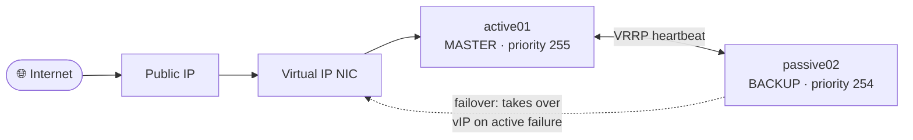
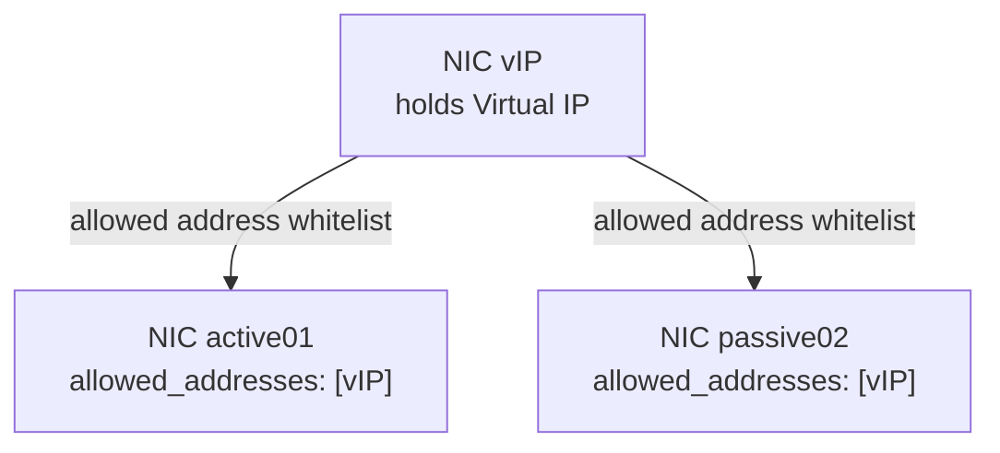

<!-- tags: iaas, ha, vrrp, networking -->

# Basic High Availability Setup Using VRRP

This guide provides a comprehensive, step-by-step process for setting up a Basic High Availability (HA)
cluster using the Virtual Router Redundancy Protocol (VRRP).
In this HA configuration, one virtual machine (VM) functions as the active primary node while the secondary
remains on standby.

> For setup instructions using the STACKIT CLI instead of Terraform, please refer to the [STACKIT CLI Guide](STACKIT-CLI-GUIDE.md).
>
> Before deploying a third-party firewall appliance in HA mode, review the [Public HA Failover-Readiness Checklist](FIREWALL-HA-READINESS-CHECKLIST.md) to verify the appliance meets all cloud and protocol requirements.

## ⚠️STACKIT-Specific Requirement: vMAC-less VRRP

**VRRP on STACKIT requires vMAC-less mode.** Standard VRRP uses a virtual MAC address
(`00:00:5e:00:01:<vrid>`) during failover. STACKIT's network fabric is based on OVN (Open Virtual
Network), which enforces strict MAC anti-spoofing: any packet with a source MAC that doesn't match
the port's registered MAC is dropped. The standard VRRP virtual MAC is not registered on the port
and therefore gets blocked.

The keepalived option `no_virtual_mac` instructs keepalived to use the real NIC MAC in all GARP
(Gratuitous ARP) packets instead of the virtual MAC. OVN allows this because the MAC matches the
registered port MAC.

> **Note on HA approaches across cloud platforms:**
> Other hyperscalers typically solve active-passive HA either via native cloud API integration
> (the failover script calls the cloud API to re-associate a floating IP) or via an L3 Load Balancer
> Sandwich. STACKIT does not yet offer an L3 Load Balancer (this is work in progress), making
> vMAC-less VRRP currently the recommended approach for active-passive HA on STACKIT IaaS.

## Testing the Setup

After completing the setup, use the [test-setup.sh](test-setup.sh) script to verify that the Apache server is operational
on each machine. Executing this script should yield the following results:

```bash
Performing curl on IP: 193.148.177.243
<center><h1>active01</h1>

Performing curl on IP: 193.148.161.92
<center><h1>passive02</h1>

Performing curl on IP: 193.148.169.230
<center><h1>active01</h1>
```

The output indicates a successfully functional VRRP setup.

### Failover Testing

To test failover, stop the active VM and perform another `curl` request to the vIP WAN IP:

```bash
vip01_wan_ip=$(terraform output -raw vip01_wan_ip)
curl $vip01_wan_ip

<center><h1>passive02</h1>
```

The response confirms that the fail-over from the active to the passive node has occurred.

> **Note:** The public IP can take up to about two minutes to follow the VIP to the new node
> (see [Failover Times](#failover-times)). If `curl` still answers with `active01` or times out,
> wait and retry. To see the exact outage, run a loop like the following during the failover:
>
> ```bash
> while true; do
>   echo "$(date +%T.%3N) $(curl -s -m 1 http://$vip01_wan_ip | grep -o '>[a-z0-9]*<' || echo FAIL)"
>   sleep 0.2
> done
> ```

## Failover Times

A failover consists of two parts:

1. **VRRP detection (guest):** keepalived on the passive node becomes MASTER, adds the VIP and
   sends GARPs (5 at 1 s intervals, followed by another 5 after `garp_master_delay`, default 5 s).
2. **Platform switchover (STACKIT):** the STACKIT network has to learn from the GARP that the VIP
   now belongs to the other port, and then deliver traffic to it.

### Why the platform switchover time varies

Processing a GARP for an allowed address is a **control plane action** in STACKIT's SDN. It is
not handled directly in the data path. Depending on other control plane actions that are active
in the region at the same time, it can take a variable amount of time. The STACKIT network team
confirmed this as known behaviour.

While the switchover is pending, the platform keeps delivering packets to the MAC of the old node,
and the new node receives nothing. This cannot be fixed from inside the VM. Additional GARPs,
unsolicited ARP replies (`arping -A`) and ARP requests to the gateway with the VIP as sender
did not resolve it in our tests. Most inbound delays ended 15–110 s after the last GARP, without
any action by a node.

### Measured values

Measured in November 2026 in `eu01` with keepalived 2.3.3 (unicast, `no_virtual_mac`), 91
inbound and 29 egress failovers. Scenarios: `systemctl stop keepalived`, interface down on the
active node, and VM stop. A failover counts as delayed if more than 5 s pass between the first
GARP and the first packet reaching the new node.

**Inbound via public IP (1:1 NAT on the VIP port, as in this example):**

| Placement of the two nodes                          | Failovers | Delayed       | Longest outage |
| --------------------------------------------------- | --------- | ------------- | -------------- |
| Same hypervisor (hard affinity)                     | 18        | 9             | 106 s          |
| Different hypervisors, same AZ (hard anti-affinity) | 18        | 14            | 99 s           |
| Different availability zones                        | 55        | 38            | 121 s          |
| **Total**                                           | **91**    | **61 (67 %)** | **121 s**      |

- Without a delay, the public IP follows the VIP 0.4–4.3 s after the first GARP (median 0.6 s,
  25 of 30 below 0.9 s).
- With a delay, the outage lasts between 7 s and about 2 minutes.
- Placement makes no significant difference (Fisher's exact test, p ≥ 0.16). Placing both
  nodes on the same hypervisor does not avoid the delay.

**Egress via routing table with next hop VIP:**

- 27 of 29 failovers switched within 0.09–0.26 s after the first GARP (once after 2.2 s).
- Twice the platform only took over the 10th GARP, which resulted in a delay of 9.1 s.
- Total outage: about 0.7 s for a planned failover and about 3.3 s if the active node loses
  its network (about 3 s of that is VRRP detection with `advert_int 1`).

**VRRP detection time (guest part):**

| Scenario                              | Detection                                  |
| ------------------------------------- | ------------------------------------------ |
| `systemctl stop keepalived` (planned) | about 0.4 s (keepalived sends priority 0)  |
| Interface down / network loss         | about 3 s (3 × `advert_int`)               |
| VM stop                               | depends on the shutdown order of the guest |

### Recommendations

- **Plan for up to about 2 minutes of inbound outage** when a public IP on a VIP port fails over.
  Do not base an SLA on a fast public IP failover.
- **Use routing tables with next hop VIP** for egress and east-west traffic. This path is much
  more robust than the 1:1 NAT path of the public IP.
- **Stop keepalived before the actual service** on shutdown, so the passive node takes over
  while the service on the active node is still answering.
- **For site-to-site VPN**, consider STACKIT's managed VPN service instead of a self-managed
  VPN appliance in VRRP mode.

## Diagrams

### HA Traffic Flow



### vIP Binding Concept


