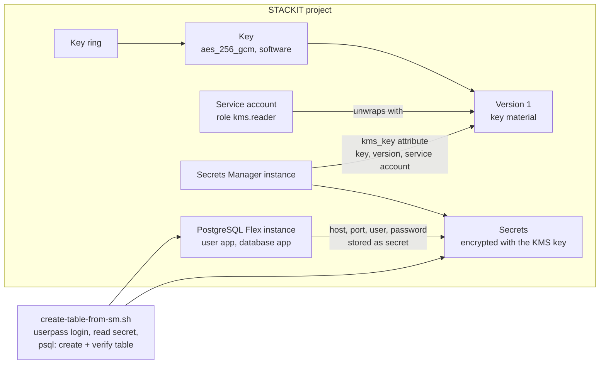

<!-- tags: secrets-manager, kms, encryption, key-management, dbaas, postgresql, vault -->

# Secrets Manager with KMS Encryption (Terraform)

## Terraform Example

Deploys a [STACKIT Secrets Manager](https://docs.stackit.cloud/products/security/secrets-manager/)
instance whose secrets are encrypted with a customer-managed key from
[STACKIT KMS](https://docs.stackit.cloud/products/security/kms/). The keyring, the key and
the service account the instance uses to unwrap the key are created in the same project
as the instance. On top of that, the example creates a small
[PostgreSQL Flex](https://docs.stackit.cloud/products/database/postgresql-flex/)
instance with a database user, stores the database credentials in the instance as a
secret, and ships a script that reads the credentials back from Secrets Manager and
creates a table in the database — a full round trip.

```bash
terraform init
terraform plan
terraform apply
```

| File                      | Contents                                                                 |
| ------------------------- | ------------------------------------------------------------------------ |
| `010-provider.tf`         | Providers (stackit, vault), endpoints, authentication                    |
| `020-variables.tf`        | All values you need to adapt                                             |
| `030-postgres.tf`         | PostgreSQL Flex instance, database user and database                     |
| `040-service-account.tf`  | Service account plus the KMS role the Secrets Manager service needs      |
| `045-sm-secret.tf`        | Secrets Manager user and the database credentials stored in the instance |
| `050-kms.tf`              | Keyring and key encryption key (KEK)                                     |
| `060-secretsmanager.tf`   | Instance with the `kms_key` attribute                                    |
| `070-outputs.tf`          | IDs, key version, service account, endpoints and the script's inputs     |
| `create-table-from-sm.sh` | Reads the credentials from Secrets Manager and creates a table in the DB |

This example was written against stackit provider `>= 0.113.0`.

## How it works



Terraform creates the keyring, the key, the service account, the PostgreSQL instance
and its user first, and only then the Secrets Manager instance and the secret — the
instance's `kms_key` attribute and the secret refer to the other resources. Because
everything is created through the stackit and vault providers, one `terraform apply`
is enough; the script then runs against the applied state.

## Prerequisites

- An existing STACKIT project (`stackit_project_id`), find it with `stackit project list`
  or in the portal.
- A service account key with a role in that project that covers creating the resources
  above and assigning roles (e.g. `owner`).
- Terraform or OpenTofu, and the `stackit` CLI for the lookups in this guide.
- `curl`, `jq` and the `psql` client for the round-trip script.
- An egress IP range you can reach the instances from; it must be part of `acls`.
- Secrets Manager is only available in `eu01`.

## Configuration

Every value comes from a variable, none is hardcoded. Copy the example file and fill it in:

```bash
cp example.tfvars terraform.tfvars
```

| Variable                           | Required | Default                  | Meaning                                                                                                                                         |
| ---------------------------------- | -------- | ------------------------ | ----------------------------------------------------------------------------------------------------------------------------------------------- |
| `stackit_project_id`               | yes      | none, Terraform asks     | Project where all resources are created.                                                                                                        |
| `acls`                             | yes      | none, Terraform asks     | Networks allowed to reach the Secrets Manager and PostgreSQL instances, e.g. `["203.0.113.10/32"]`. Without a correct entry you cannot connect. |
| `stackit_service_account_key_path` | no       | `./keys/stackit-sa.json` | Key file Terraform authenticates with. See _Authentication_.                                                                                    |
| `stackit_region`                   | no       | `eu01`                   | Region for every resource in this example. Secrets Manager only exists in `eu01`.                                                               |
| `name_prefix`                      | no       | `sm-kms-example`         | Name prefix for instance, keyring, key and service account.                                                                                     |
| `kms_key_version`                  | no       | `1`                      | Key version the Secrets Manager instance uses for encryption. The key is created with version 1.                                                |
| `postgres_flavor_id`               | no       | `2.4`                    | Size of the PostgreSQL Flex instance. `stackit postgresflex flavor list` shows the valid ones.                                                  |
| `postgres_storage_class`           | no       | `premium-perf2-stackit`  | Storage class of the PostgreSQL Flex instance.                                                                                                  |
| `postgres_storage_size`            | no       | `10`                     | Storage size in GB.                                                                                                                             |
| `postgres_version`                 | no       | `17`                     | PostgreSQL major version.                                                                                                                       |
| `postgres_backup_schedule`         | no       | `0 2 * * *`              | Daily backup time in UTC.                                                                                                                       |
| `postgres_retention_days`          | no       | `32`                     | How long backups are kept, between 32 and 90.                                                                                                   |

The database user is named `app` and the database `app`; the table the script creates
and the Secrets Manager Vault address are `locals` in `010-provider.tf`.

### Authentication

Terraform authenticates with a service account key file. This account is **not** the one
referenced by the `kms_key` attribute; that one is created by this example.

```bash
mkdir -p keys
stackit service-account create --name terraform-sa
stackit service-account key create --email terraform-sa-xxxxxxx@sa.stackit.cloud > keys/stackit-sa.json
```

Set `stackit_service_account_key_path` to the file and keep the file out of version
control. The JSON must contain the `credentials.privateKey` field, which
`stackit service-account key create` includes when it generates the key pair for you.

## Creating a table with the credentials from Secrets Manager

After `terraform apply`, `create-table-from-sm.sh` proves the stored credentials work:
it logs in to the Secrets Manager Vault API with the user Terraform created, reads the
secret, and connects to the PostgreSQL instance with `psql` using the credentials found
in it — nothing has to be copied into a config file or an environment variable:

```bash
./create-table-from-sm.sh
```

The script creates the table (idempotently), inserts one row, and then verifies the
table exists by querying `to_regclass`. Run it from the example directory: it reads
everything it needs (Vault address, instance ID, secret name, user, password, and then
the database credentials from the secret) from `terraform output`, so it always runs
against the state in this directory. Run it again any time — it only adds a row.

## Key rotation

`stackit kms key rotate` adds version N+1 to the key. The running instance stays pinned
to the version in the `kms_key` attribute. To move the instance to the new version, raise
`kms_key_version` and review the plan — the `kms_key` attribute is updatable in place, the
instance is not replaced. Whether the API re-encrypts secrets that were already written
under the old version is not documented by the provider; if that matters to you, verify
the behavior in a test project before relying on it. Note that the credentials secret
itself is re-encrypted transparently by the instance, no action needed there.

The key material of a version the instance is pinned to must stay usable for the whole
lifetime of the instance. Deleting or destroying that version makes the instance's
secrets unreadable — including the one the round-trip script depends on. Record the key
version (it is in the outputs) before you plan any key maintenance.

## Cleaning up

`terraform destroy` removes the secret, the Secrets Manager user and instance, the
PostgreSQL user, database and instance (Terraform orders these so the instance is
emptied before it is destroyed — destroying it also deletes its backups), the keyring
and the key, and the service account. The KMS resources are scheduled for deletion by
the API, not removed instantly — within the deletion window you can bring the key back
with `stackit kms key restore`. The provider does not delete the keyring from the API;
it only removes it from the Terraform state.

## Related examples

| Example                                                                                 | Why it is relevant here                                                                                                                       |
| --------------------------------------------------------------------------------------- | --------------------------------------------------------------------------------------------------------------------------------------------- |
| [`dbaas-postgresql-kms-encryption`](../dbaas-postgresql-kms-encryption)                 | The same PostgreSQL Flex instance with its volume and backups encrypted by KMS, including the full key lifecycle, rotation and restore rules. |
| [`iaas-volume-encryption`](../iaas-volume-encryption)                                   | The same KMS key type for an encrypted block storage volume, including a migration path from an unencrypted volume.                           |
| [`secretsmanager-vault-terraform-provider`](../secretsmanager-vault-terraform-provider) | Writing secrets into a Secrets Manager instance with the HashiCorp Vault provider, without KMS.                                               |
| [`iam-custom-roles`](../iam-custom-roles)                                               | If `kms.admin` is too broad for your project, build a custom role that carries only `kms.key.version.decrypt` and `kms.key.version.encrypt`.  |
