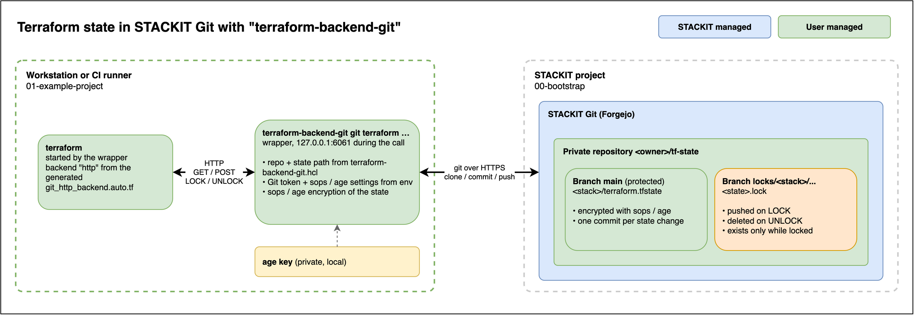

<!-- tags: terraform, git, state, backend, remote-state, locking, encryption, sops, age -->

# STACKIT Git as Terraform Backend with State Locking (terraform-backend-git)

This example stores Terraform state in a repository on a [STACKIT Git](https://docs.stackit.cloud/products/developer-platform/git/) instance, with state locking, state history and encryption at rest. It uses the community tool [plumber-cd/terraform-backend-git](https://github.com/plumber-cd/terraform-backend-git), a small wrapper around Terraform that implements the Terraform `http` backend protocol on top of plain `git` operations.

You run `terraform-backend-git git terraform <command>` instead of `terraform <command>`. Each Terraform directory only needs a small `terraform-backend-git.hcl` that names the state repository and the state path.

It needs no additional infrastructure besides the Git instance and no feature on the Forgejo side: everything runs over normal `git clone`, `git push` and branch deletes.

To resolve the circular dependency of provisioning a state backend using Terraform, the deployment is split into two isolated stages:

1. [`00-bootstrap/`](00-bootstrap/): Provisions a STACKIT project and the STACKIT Git instance. Its state stays local.
2. [`01-example-project/`](01-example-project/): Represents the primary infrastructure and uses a repository on that Git instance as its remote backend.

---

## How it works

| Terraform operation | What happens in the state repository                                                                                                            |
| ------------------- | ----------------------------------------------------------------------------------------------------------------------------------------------- |
| **Lock**            | A branch `locks/<state path>` with a `<state path>.lock` file is pushed. If the branch already exists, the push is rejected and the lock fails. |
| **Read state**      | The state file is read from the configured branch (`main`) and decrypted with sops/age.                                                         |
| **Write state**     | The state is encrypted with sops/age and committed to `main`. Every `apply` becomes one commit, so you get a full, diffable state history.      |
| **Unlock**          | The `locks/<state path>` branch is deleted.                                                                                                     |

## Security considerations

- **Encrypt the state.** Without encryption, every secret in your state (passwords, keys, tokens) ends up in plain text in the Git history and cannot be removed easily. `terraform-backend-git` only encrypts when the sops/age variables are set (see [`.env.example`](.env.example)); otherwise it silently stores plain text.
- **Use a dedicated, private repository** for state files only.
- **Restrict the Git instance ACL.** The bootstrap takes the allowed CIDRs as a variable. This applies if you use STACKIT Git dedicated for this use case.

## Limitations

- **Community tool.** `terraform-backend-git` is maintained by a open source community.
- **Repository growth.** Every `apply` stores the full (encrypted) state as a new commit.

## Alternatives

If a managed, officially supported backend matters more than state history in Git using 3rd party tooling, then use STACKIT PostgreSQL Flex as backend, see [`terraform-pg-backend-state-locking`](../terraform-pg-backend-state-locking/).
In the future you might use S3 Backend with state locking. The condition is the feature `conditional write` for [STACKIT Object Storage](https://docs.stackit.cloud/products/storage/object-storage/) which is on the roadmap.
