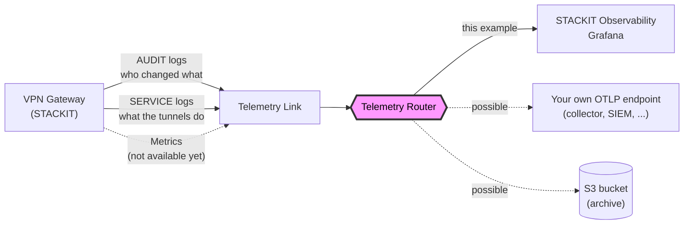
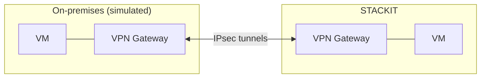
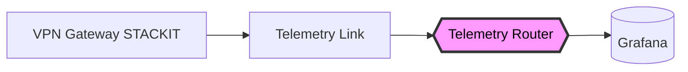
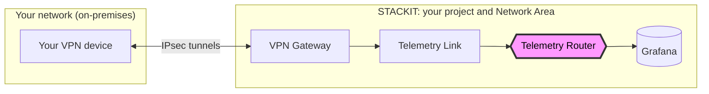
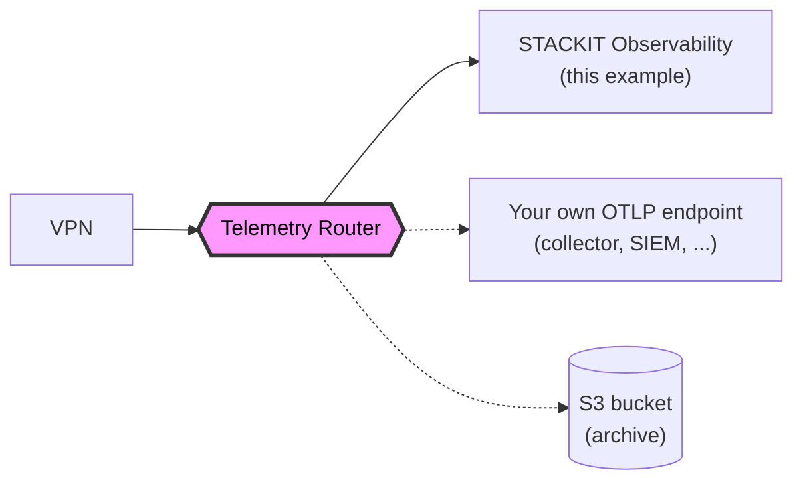

<!-- tags: vpn, telemetry, otel, observability, logging, terraform -->

# VPN Telemetry

You run a VPN between your own network (on-premises) and STACKIT and want to know what the VPN reports about itself. This example shows which records the VPN sends and how you get them into Grafana.

**Short answer:** the VPN sends **logs** (what was changed, what the tunnels do). It does **not** send metrics yet, they are announced for a later release.

## Which way fits you?

| I want to...                               | Go to                                                  |
| ------------------------------------------ | ------------------------------------------------------ |
| Build the example VPN and see what arrives | [Path A: example VPN](#path-a-build-the-example-vpn)   |
| Use it with a VPN I already run            | [Path B: my own VPN](#path-b-use-it-with-your-own-vpn) |

## What you get



| Log type  | What it tells you           | Examples                                                                      |
| --------- | --------------------------- | ----------------------------------------------------------------------------- |
| `AUDIT`   | Who changed what in the VPN | Gateway created, connection created, with e-mail of the user and the settings |
| `SERVICE` | What the tunnels are doing  | Connection started, established, key renewal (rekeying), errors               |

- **Telemetry Router:** a STACKIT service, not a network router. It collects the logs of linked projects and passes them on to one or more targets. It has nothing to do with the routing of your VPN traffic.
- **Telemetry Link:** connects a project to the Telemetry Router. Without a link the Telemetry Router gets nothing.
- **Destination:** where the Telemetry Router sends the records. You can have several at once. This example uses STACKIT Observability, but you can also send to your own OTLP endpoint or an S3 bucket, see [Other targets](#other-targets-than-grafana).
- **Observability:** the STACKIT service behind Grafana. It stores the logs and shows them.

The VPN logs events, not a constant stream. A stable tunnel that nobody touches logs little, so Grafana can stay quiet for a while. That is normal.

## And how do I watch my tunnels then?

Without metrics there is no tunnel graph yet. What you can use today is the **connection status** of the VPN (also shown in the Portal): whether each tunnel is established, the state of the key exchange, bytes and packets, and the BGP sessions with their routes. It is polled, not pushed, for example with your own script. Logs and status complement each other: the status tells you how it is now, the logs tell you what happened.

## Before you start

- **Terraform** `>= 1.11`.
- **A service account with a key** from the STACKIT Portal. Put the path to the key file into `stackit_service_account_key_path`.
- **Your organization ID** (only Path A), to create the two projects of this example.
- Rights to create projects, VPN gateways and Observability instances.

## Path A: build the example VPN

> **This setup is specific to this example.** In reality your network is on-premises, outside of STACKIT, and you have **one** Network Area on STACKIT: the one your VPN gateway lives in (depending on your architecture). We have to build the on-premises side on STACKIT as well to have a complete VPN to look at. Only the STACKIT side is monitored, STACKIT cannot read out the gateway of your on-premises network.

Two projects are created. The Telemetry Router and Grafana go into the STACKIT project, next to the VPN gateway:

| Project                     | Role                                                                          | Created by   |
| --------------------------- | ----------------------------------------------------------------------------- | ------------ |
| **On-premises (simulated)** | Plays your own network. It is only a second Network Area with its own project | This example |
| **STACKIT**                 | Your STACKIT side of the VPN, with Telemetry Router and Grafana               | This example |





Why two Network Areas in this example: projects in the same area talk to each other directly and would never use the VPN. Two areas force the traffic through the tunnels. With your own VPN you do not need the second one.

Both sides use the module [stackit-sna-with-debug-machine](../../modules/stackit-sna-with-debug-machine/). Its machines have port security disabled and a known password. **Not for production.**

### Steps

**1. Configure**

```bash
cp terraform.tfvars.example terraform.tfvars
```

Fill in the organization ID, your e-mail and the path to the key.

**2. Create everything**

```bash
terraform init
terraform apply
```

The gateways take several minutes, they are the slowest part. Two gateways and two machines are billed while they exist, check the prices of the gateway plan and the machine type before you start.

**3. Open Grafana and import the dashboard**

Open the URL from the output `grafana_url` and sign in with your STACKIT account (Owner role in the STACKIT project). The instance has no default admin user, you sign in with STACKIT SSO.

Then import the ready-made dashboard: **Dashboards**, **New**, **Import**, upload `dashboards/vpn-telemetry.json`, choose the data sources if asked and click **Import**. It shows the VPN log lines, errors, the tunnels that report, and the log lines of both types.

**4. Look at the logs yourself**

For your own questions use **Explore** and the data source **Loki**. Loki is the log store of Grafana. Paste a query into the field, choose a time range such as _Last 3 hours_ and click **Run query**:

```
{service_name="vpn"}
```

shows all VPN logs. Add a filter to see one type only:

```
{service_name="vpn"} | stackit_log_type="AUDIT"
{service_name="vpn"} | stackit_log_type="SERVICE"
{service_name="vpn"} | detected_level="ERROR"
```

You should see the creation of the STACKIT gateway and its connection (`AUDIT`) and the tunnels starting (`SERVICE`). An `ERROR` while the tunnels start can happen and is not a problem if the tunnels are established afterwards.

**5. Use the VPN (optional)**

```bash
ssh debug@<onprem_public_ip>
ping <stackit_private_ip>
```

Both addresses are outputs of `terraform apply`. Answers to the ping show that the traffic goes through the tunnel. The password of the machines is the one of the module (see its `debug-user.yml`). If the ping does not answer right after `terraform apply`, wait a few minutes: the routes between the two networks first have to be learned.

**6. Clean up**

```bash
terraform destroy
```

## Path B: use it with your own VPN

This is the real case. Your network is on-premises, the VPN gateway lives in your STACKIT Network Area, and only this side can be monitored. You do not need the example VPN. The Telemetry Router, Grafana and the Telemetry Link go into the project that contains your VPN gateway.



1. Remove what belongs to the example VPN:
   - delete `035-vpn.tf`,
   - delete the two outputs `onprem_public_ip` and `stackit_private_ip` in `060-outputs.tf`,
   - delete the variables `stackit_org_id` and `stackit_admin_email` in `020-variables.tf` and in your `terraform.tfvars`.
2. In `030-telemetry-router.tf` replace `module.stackit.project_id` with the ID of the project that contains your VPN gateway:

```hcl
locals {
  project_id = "<project with your VPN>"
}
```

3. Run `terraform apply` and continue with step 3 above.

The link takes over all VPN logs of the project. Changes you make at your VPN from now on show up as `AUDIT` logs. For further projects with a VPN add one more `stackit_telemetrylink` in `050-telemetry-link.tf` with the ID of that project as `resource_id`.

## Other targets than Grafana

Grafana is only the example. The Telemetry Router sends the records to **destinations**, and you can have several at once, each with its own filter.



| Destination           | Setting                                                            | Checked                            |
| --------------------- | ------------------------------------------------------------------ | ---------------------------------- |
| STACKIT Observability | `config_type = "OpenTelemetry"`                                    | Yes, this is what the example does |
| Any OTLP endpoint     | `config_type = "OpenTelemetry"`, `uri`, Basic Auth or bearer token | No                                 |
| S3 bucket             | `config_type = "S3"`, bucket, endpoint, access key                 | Yes, in an earlier run             |

An additional OTLP destination in `040-observability.tf` looks like this:

```hcl
resource "stackit_telemetryrouter_destination" "my_target" {
  project_id   = local.project_id
  instance_id  = stackit_telemetryrouter_instance.this.instance_id
  display_name = "my-target"

  config = {
    config_type = "OpenTelemetry"

    filter = {
      attributes = [
        {
          key     = "service.name"
          level   = "logRecord"
          matcher = "="
          values  = ["vpn"]
        },
      ]
    }

    opentelemetry = {
      uri          = "https://<your-otlp-endpoint>"
      bearer_token = var.my_target_token
    }
  }
}
```

What is **not** certain:

- We only checked the delivery to STACKIT Observability. Whether your endpoint accepts the records depends on the endpoint. Try it with a small filter first.
- The filter works on attributes (such as `service.name`), not on the kind of signal. It cannot say "only metrics".
- The Observability instance of this example takes logs only. When VPN metrics are available, they need a destination that accepts metrics.

## Settings

| Variable                           | Meaning                                       |
| ---------------------------------- | --------------------------------------------- |
| `stackit_org_id`                   | Your organization (Path A)                    |
| `stackit_admin_email`              | Owner of the two example projects (Path A)    |
| `stackit_service_account_key_path` | Service account key, optional                 |
| `name_prefix`                      | Prefix for all names, default `vpn-telemetry` |
